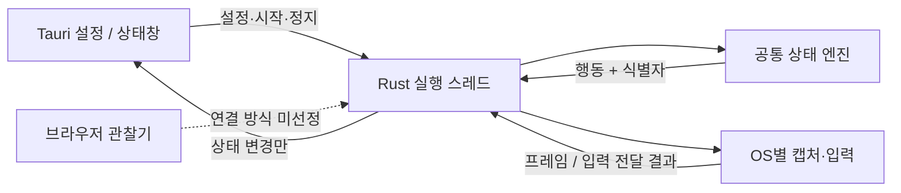

# 구현 상태와 다음 검증

## 0.5.9 이후 소스 수정 — 좌석 정확도 (미배포)

선택 후 색상 성분의 경계 변화로 같은 물리 좌석에 새 ID가 부여되어 반복 클릭·집계되는 결함을 수정했다.
전달한 원래 후보 geometry와 실제 target point를 기억하고 현재 구역의 유지/실패 제외 집합과 연동한다.
미전달 취소는 기록하지 않고 실패 후보 재시도는 해당 기록만 해제한다. 기존 성공 추정 방식은 유지한다.

좌석 전용 추출과 클릭 직전 검사는 불투명한 2×2 색상 영역을 요구한다. 구역 추출은 기존 방식이다.
`features.adjacent_seats`(UI ‘연석 우선’, 기본 OFF)는 같은 줄의 그룹을 우선하며,
목표 매수 그룹이 없으면 부분 그룹·분리 좌석으로 채운다. 좌석 번호를 읽지 않는 기하학적 추정이다.

JavaScript 143개·Rust 297개(440개), 독립 UI 24조건 및 코드 교차검토를 통과했다.
전체 Worker·실제 OS 입력·공연 화면 검사는 하지 않았고, 앱 버전·배포 파일은 변경하지 않았다.
얇은 정상 외곽선 제외, 같은 색 비좌석 통과, 사이트가 입력을 조용히 무시하는 경우는 여전히 한계다.
자세한 근거: [좌석 정확도 검사](../verification/adjacent-seat-audit/README.md).

## 0.5.9 실험용 배포

0.5.8 이후 키보드 수신·공통 동작·취소표·우선순위 검토에서 수정한 코드를 함께 배포한다.
macOS 전역 키 감시의 수신 PID 별칭 처리와 입력 큐, 앱 내부 키보드 수신 검사,
설정 저장·F8·시작·중지 순서 충돌, 취소표 모드별 옵션 적용, 투명 캡처 거부,
이미지 후보의 배율 좌표 변환 수정을 포함한다. 기존 입장 클릭 순서와 선택 추정 정책은 유지한다.

`node scripts/check.mjs --native --build`가 종료 코드 0으로 완료됐다.
JavaScript 141개·Rust 270개, Swift arm64/x86_64 컴파일·호스트 ABI,
앱 빌드·서명·소스 96개 파일 동일성 검사를 통과했다. 배포 앱은 arm64·macOS 13 이상용이다.
ZIP 재추출 뒤 파일 해시·권한·서명도 일치했다. 결과는
[`local-checks-0.5.9.json`](../verification/local-checks-0.5.9.json) 및
[`build-0.5.9.log`](../verification/build-0.5.9.log)에 기록한다.
앱 식별자·설정 경로·로컬 ad-hoc 서명을 유지하고, 기존 0.5.8 앱과 ZIP은 보존한다.
새 앱 실행 전 구버전을 완전히 종료해야 한다. 권한 자동 승계는 보장하지 않는다.

실제 예매창에서 첫 문자 기준 저장, 캡챠 닫힘 뒤 진행, 버튼 갱신 OFF 취소표 반복 탐색,
좌석 클릭·F4 중지를 확인해야 한다. Windows 빌드와 실제 OS 입력·캡처는 이번 자동 검사의 범위 밖이다.
구역 전환 완료의 의미 판별, 늦은 오류창의 좌석 귀속, 색상 후보 오인·누락,
선택 추정과 실제 선택 불일치 한계는 [우선순위 검토](../verification/priority-audit/README.md)에 남겨 둔다.
아래 기록은 각 과거 버전의 검증 결과다.

## 0.5.8 빌드·서명 검사 완료 — 첫 문자 입력 기준 저장과 F9 진행

사용자 승인에 따라 기존 미배포 기능을 Apple Silicon(arm64)·macOS 13 이상용 0.5.8로
빌드했다. OCR·문자 자동 풀이는 포함하지 않는다. JavaScript 123개·Rust 208개(합계 331개),
Swift arm64/x86_64 컴파일·호스트 ABI 검사, 앱 빌드·서명 검사와 검사 전후 소스 81개 파일의
동일성 확인을 통과했다. 결과는 [`local-checks-0.5.8.json`](../verification/local-checks-0.5.8.json),
로그는 [`build-0.5.8.log`](../verification/build-0.5.8.log)에 있다.
기존 0.5.7 앱과 배포 파일은 보존한다.

사용자가 ‘첫 입력 기준으로 저장’하도록 확정해 고정 NOL 제목·패널 모양 검사를 제거했다.
`NOL 캡챠 판단` 옵션 이름과 기본 OFF 설정은 유지한다. 옵션을 켠 일반 예매에서
등록한 날짜·회차·다음 버튼 입력이 끝난 캡챠 대기 중, 연결한 예매창의 첫 영문자·숫자
키 입력(Shift 허용)을 기준 저장 신호로 사용한다. 입력 글자 내용은 수집하거나 저장하지 않는다.

첫 입력은 좌하단 패치(x 3%, y 88%, 너비·높이 각 4%)의 불투명한 25점 RGB를 한 번 저장할 뿐,
마우스 이동·클릭이나 구역·좌석 진행을 시작하지 않는다. 이후 각 점의 RGB 최대 절댓값 차이가
45 이상인 표본이 20개 이상인 상태를 100ms 확인하면 구역·좌석부터 이어간다.
밝아짐·어두워짐·등휘도 색 변화를 같은 조건으로 비교하며 후속 타이핑·오답 재입력은 기준을 갱신하지 않는다.
기존 진입 버튼 순서·간격, NOL의 Enter보다 높은 우선순위, 최초 클릭 전 색 변화 재확인은 유지한다.

캡챠를 직접 타이핑하면 기준을 자동으로 저장하므로 추가 버튼이나 좌표 설정을 요구하지 않는다.
같은 예매창의 다른 입력란은 구별하지 못하며 붙여넣기·자동완성만으로는 첫 문자 신호가 없을 수 있다.
그때는 캡챠를 직접 완료한 뒤 F9 **캡챠 이후 진행**을 사용한다. F9는 등록한 입장 처리가 끝난
일반 예매의 캡챠 대기에서만 구역·좌석부터 이어가며 원래 진입 버튼을 다시 누르지 않는다.
구역 자동 선택을 끄면 좌석부터 탐색하고 해당 대기의 일시정지에서도 재개할 수 있다.
중지 상태의 새 실행이나 좌석 선택 중 재시작에는 사용하지 않는다.
패치의 다른 화면 변화와 실제 캡챠 해제는 구분하지 못하며, 실제 macOS 정답·오답 입력 전환과
Windows 실행은 미검증이다.

첫 키 알림보다 캡처가 늦게 도착하면 잠시 관측을 이어간다. 입력 시점 이후 250ms 안에 확인된
유효한 프레임에서만 기준을 저장하며, 늦은 프레임·중지·연결 변경은 기준 저장에 쓰지 않는다.
기준 채집이 실패하면 다음 문자 입력에서 다시 시도하고, 성공하면 문자 감시를 해제한다.

버전 변경 전 소스는 JavaScript 123개·Rust 208개(합계 331개) 테스트와
Swift arm64/x86_64 컴파일·호스트 ABI 검사를 통과했다.
첫 입력과 완료 신호 분리, 최초 기준 고정, 입력 전 로딩 변화 무시, 입력/화면 시각 검사,
기존 Enter 필터와 문자 감시의 독립성, F9 및 기존 엔진 회귀를 포함한다.
검사 전후 소스 75개 파일 해시가 일치했다. Windows 전용으로 추가한 테스트 4개는 이 실행 수에 포함되지 않으며,
Windows 컴파일·실행 및 실제 예매창의 입력 전환은 미검증이다.
결과: [`captcha-first-input-checks.json`](../verification/captcha-first-input-checks.json).
이 결과는 0.5.8 배포 빌드 검증을 대신하지 않는다. 배포 앱은 로컬 ad-hoc 서명을 사용하며
Apple 공증은 하지 않는다. 기존 앱을 완전히 종료하고 새 앱으로 교체·실행한 뒤 옵션과 예매창
연결을 확인한다. 앱 식별자·설정 경로는 유지하지만 설정·권한의 자동 승계는 보장하지 않는다.
입력·캡처 실패 시 새 앱의 손쉬운 사용·화면 기록 권한을 확인해야 한다.
아래 F9·0.5.7 검사 결과는 각각 당시 소스에 대한 기록으로 0.5.8 검증과 구분한다.

## 이전 소스 검사 기록 — F9 캡챠 이후 진행

2026-10-21의 0.5.7 실행 기록을 확인했다. 이전 화면의 두 실행은 패널 발견·25점 기준 저장·
색 변화 후 진행을 기록했다. 이후 다른 공연의 실행 4~6은 배경 RGB가 (255,255,255)에서
(137,137,137)로 바뀌었지만 계속 `searching_for_panel`, `panel: null`, `baseline_samples: 0`이었다.
25점 모두 불투명하고 프레임도 갱신됐다. 색 변화 방향이나 20점 문턱 이전의 최초 패널 인식에서 막혔다.
닫히기 전 캡챠 화면이 없으므로 제목·크기·패널 경계 중 어느 조건에서 탈락했는지는 확정하지 못했다.
로그 요약은 `verification/captcha-manual-continue-diagnosis.json`에 기록하며 입력 문자·주소는 포함하지 않는다.

F9 **캡챠 이후 진행**은 등록한 입장 입력이 모두 끝난 일반 예매의 캡챠 대기에서만 허용한다.
사용자가 직접 캡챠를 완료한 뒤 누르는 확인이며, 자동 정답 판정은 하지 않는다.
연결한 예매창을 확인한 뒤 원래 입장 좌표를 반복하지 않고 구역 또는 좌석부터 탐색한다.
해당 캡챠 대기의 일시정지 상태도 명시적으로 재개할 수 있다. 좌표 지정 중·입장 중·다른 모드·
좌석 선택 중·중지 상태에서는 새 실행이나 선택 수 초기화를 하지 않는다.
F4·F8 등 후속 제어가 도착하면 이전 F9 요청은 취소한다.
F1·F2·F5의 새 실행 준비 중 받은 F9도 실제 실행 시작 시각보다 이른 요청이면 취소한다.

수동 확인 뒤에는 기존 NOL 판정의 첫 클릭 재검사를 적용하지 않는다. 미인식 기준값 때문에
다시 캡챠 대기로 돌아가는 것을 방지하고, 새 화면을 받아 기존 구역·좌석 탐색을 이어간다.
자동 감지 옵션을 모두 꺼도 유효한 F9 이후에는 이 실행에서만 연속 탐색을 사용한다.
당시 변경은 자동 감지 조건·원래 진입 클릭·기존 단축키를 유지했다. 이 변경의 앱 빌드는 아직 하지 않았다.

JavaScript 123개·Rust 201개 테스트를 통과했다. 회귀는 옵션 조합별 진행, 원래 입장 클릭 순서,
빈 좌석 재탐색, 잘못된 단계·반복 F9 거절, 캡챠 대기 일시정지 재개, 중지·좌표 지정·새 실행과의
순서 충돌을 포함한다. 실제 예매창의 F9 입력과 Windows 실행은 미검증이다.
결과·소스 해시·배포본 보존 확인: [`captcha-manual-continue-checks.json`](../verification/captcha-manual-continue-checks.json).

## 0.5.7 NOL 배경 색 변화 — 앱 빌드·서명 검사 완료

0.5.6 사용 중 캡챠가 남아 있는데 구역 클릭으로 진행했다는 보고와,
실행 기록의 닫힘 판정·구역 클릭 전달을 확인했다. 당시 원본 캡처 프레임이 없어
어떤 화면 변화가 닫힘 판정을 만들었는지는 확정하지 못했다. 기존 진입 버튼 3회 클릭은 유지한다.

배포된 0.5.7에서는 최초 NOL 고정 제목을 캡챠 창의 존재 확인에 사용했다. 닫힘 신호는 연결한 창의
좌하단 패치(x 3%, y 88%, 너비·높이 각 4%)에서 채집한 5×5 점의 색 변화로 변경했다.
처음 채집할 때 패치가 캡챠 패널 밖에 있어야 하며 25점의 알파가 모두 250 이상이어야 한다.
회색·밝기 범위 제한 없이 당시 RGB를 저장하고 입력 중에는 기준값을 갱신하지 않는다.
각 점에서 R·G·B 중 가장 큰 절댓값 차이가 45 이상이면 변화로 세고,
25점 중 20점 이상이 바뀐 상태를 100ms 확인하면 진행한다. 밝아짐·어두워짐·색상 변화를
같은 조건으로 비교하며 입력칸·버튼·제목의 변화는 닫힘 조건에 사용하지 않는다.
NOL 판정은 Enter보다 우선하며 문자 자동 풀이는 하지 않는다.

최초 구역 클릭 또는 구역 선택을 끈 경우 최초 좌석 클릭 직전에 최신 유효 프레임으로
같은 색 변화 조건을 다시 확인한다. 기준과 충분히 다른 상태가 유지되면 추가 고정 대기 없이 진행하며,
기준으로 돌아왔거나 유효하지 않으면 미전송 후보를 취소하고 캡챠 대기로 돌아간다.
좌석 색과 안내창 기준도 같은 프레임을 사용하며 완료된 진입 버튼은 다시 누르지 않는다.

제공된 이미지의 Chrome 창 영역(3024×1780)에서는 25점 모두 불투명한 배경이었고
평균 RGB는 (112, 112, 115)였다. 전체 이미지·창 영역·배율 변형 3종의 총 5종에서도
존재와 배경 색을 확인했다. 이는 한 장의 위치·색 검사이며 실제 정답·오답 입력 전환 검증은 아니다.
이전 밝기 조건에서 측정한 이미지 기록: [`nol-backdrop-patch-check.json`](../verification/nol-backdrop-patch-check.json).
불투명한 전체 흰색·검정색 대체 캡처와 실제 배경 변화는 이 방식으로 구별할 수 없고,
패치의 배경이 별도로 바뀌면 오인하거나 계속 대기할 수 있다. 실제 Windows 실행도 미검증이다.
기존 0.5.6 앱·배포 파일은 보존한다. 아래 0.5.6 빌드 기록은 이번 소스 수정에 적용되지 않는다.

버전 변경 전 소스는 JavaScript 123개·Rust 190개 테스트를 통과했다.
감지기 24개 회귀에는 밝아짐·어두워짐·등휘도 색 변화, 잡음·부분 변화 거부, 입력 영역 변화,
고정 기준 유지, 정지 프레임, 확대·잘린 패널, 투명 캡처 거부와 회복, 최초 클릭 재확인을 포함한다.
검사 수치·소스 해시·남은 한계는 [`nol-backdrop-color-checks.json`](../verification/nol-backdrop-color-checks.json)에 기록했다.
사용자가 배포 빌드를 승인해 0.5.7로 버전을 올렸다. `node scripts/check.mjs --native --build`가
exit 0으로 완료됐고 JavaScript 123개·Rust 190개, Swift arm64/x86_64 컴파일·네이티브 검사,
앱 빌드·서명, 검사 전후 소스 81개 파일 일치를 확인했다.
기록은 `verification/build-0.5.7.log`와 `verification/local-checks-0.5.7.json`에 보존한다.
배포 앱은 Apple Silicon arm64·macOS 13 이상용이며 앱 식별자·설정 경로를 유지한다.
빌드 검사는 실제 NOL 입력 전환 또는 예매 성공 검증을 대신하지 않는다.

## 0.5.6 변경과 검증

사용자의 빌드 승인에 따라 0.5.6 Mac 앱 빌드를 완료했다.
`node scripts/check.mjs --native --build`가 exit 0으로 끝났으며 JavaScript 123개·Rust 178개,
Swift arm64/x86_64 컴파일·네이티브 검사, 앱 빌드·서명 검사를 통과했다.
검사 전후 소스 81개 파일의 해시가 일치한다. 기록은 `verification/local-checks-0.5.6.json`과
`verification/build-0.5.6.log`에 있다. 배포 대상은 `Integrated-Macro-macOS-v0.5.6`이며
기존 0.5.5 앱·ZIP은 보존한다. 이 결과는 ZIP 포장 검증이나 실제 예매 동작을 대신하지 않는다.
앱 식별자와 설정 경로는 유지하며 로컬 ad-hoc 서명을 사용한다. Apple 공증은 하지 않았고 권한 유지는 보장하지 않는다.

별도 `features.nol_captcha_detection` 옵션을 **NOL 캡챠 판단**으로 추가했다.
기존 설정에는 기본 false를 적용하며 Enter 진행 옵션과 독립적으로 저장한다.
일반 예매의 등록한 날짜·회차·다음 버튼 순서를 유지한 뒤 수동 입력한 NOL 캡챠 창의
소멸로 구역·좌석 탐색을 시작한다. 두 옵션을 켜면 NOL 판정이 우선하므로 Enter만으로
대기를 해제하지 않는다. 취소표와 좌석 바로 탐색에는 적용하지 않으며 문자 자동 풀이는 하지 않는다.
UI는 저장 전 옵션을 F1/F2/F5에 전달하며, NOL 진행은 연속 좌석 탐색 정책으로 표시한다.
실제 정답·오답 제출 화면이나 동영상에 대한 검증은 아직 없으며 기존 배포본은 변경하지 않았다.
NOL 옵션 추가 후 JavaScript 전체 123개 테스트와 변경 JS 구문 검사를 통과했다
(`verification/nol-captcha-ui-tests.log`). 기본 OFF·독립 저장·NOL-only 진입·현재 단축키 옵션과
Enter 안내보다 우선하는 NOL 상태 표시를 검사했으며 실제 캡챠 판별 정확도를 검증한 것은 아니다.

배포된 0.5.6의 화면 판별은 제공된 한국어 NOL 모달의 고정 제목과 흰 테두리를 먼저 찾고,
그 표식과 테두리가 없어지며 주변의 밝은 배경이 복구된 상태를 100ms 이상 확인한다.
캡챠 문제 그림·입력값·버튼 활성색은 읽지 않는다. 감시 중에는 최대 약 25회/초
네이티브 관측을 요청하며, macOS의 같은 이미지에는 메타데이터만 갱신한다.
안정 구간은 실제 창/캡처 유효성 검사를 통과한 시각으로 계산하므로 SCK의 idle
콜백이 계속 발생할 필요는 없다. 가림·일시정지·캡처 실패는 안정 구간을 취소한다.

배포된 0.5.6 판별은 단일행 제목과 화면 안에 온전히 보이는 패널, 주변의 흰 배경 복귀를
전제로 한다. 캡챠 디자인·언어·글꼴이 다르거나 패널이 잘린 경우,
닫힌 뒤 배경이 연회색·이미지인 경우에는 계속 대기할 수 있다.
처음부터 캡챠가 닫힌 화면에서는 소멸을 추정하지 않는다. 그 상태로 시작할 때는
해당 옵션을 끄거나 이미 열린 좌석 화면에서 좌석 바로 탐색을 사용한다.
소멸은 구역·좌석 탐색을 시작하는 신호이며 정답 인정이나 다음 화면 준비를 보증하지 않는다.

버전 변경 전 소스 검사에서는 JavaScript 123개와 Rust 178개 테스트, JS 구문 검사,
검사 전후 소스 81개 파일의 동일성 확인을 통과했다. 제목 마스크도 소스 해시에 포함한다.
감지 테스트 14개에는 입력 영역 변화, 무관한 팝업, 페이드, 정지 화면, 중지/가림 후
재확인, 소멸 뒤 빈 좌석 탐색 지속을 포함했다. 제공 사진의 전체·창 영역·크기 변형
5종에서 존재 표식을 찾았으며 실제 닫힘 전환의 실증과는 구분한다.
기록: `verification/nol-captcha-source-checks.json`,
`verification/nol-captcha-screenshot-check.json`. 해당 기록은 앱 빌드 전 검사이며
이번 0.5.6 패키지 검증과 구분한다. Windows 실제 실행은 미검증이다.

F5를 좌석 바로 탐색으로 추가했다. F1 일반 예매·F2 취소표와 같은 요청 ID 기반 경로에서
현재 UI 설정을 읽고 해당 모드 검증·저장 뒤 시작한다. F5는 좌석 영역을 검증하지만
일반 예매의 예약 시각·진입 버튼 설정을 요구하거나 기존 옵션을 변경하지 않는다.
초기화 중·다른 요청 처리 중·검증/저장 실패에는 시작하지 않으며,
취소·오래된 응답은 UI 저장 표시를 바꾸지 않는다. F1/F2/F5는 실행 방식 라디오를 덮어쓰지 않는다.
F2도 저장 전의 새로고침 OFF·취소표 클릭 간격을 적용하며 일반 예매 전용 검증을 적용하지 않는다.
F5는 브라우저 새로고침 키를 보내는 기능이 아니다.

한 구역 취소표의 공통 좌석 색상·영역·완료 버튼 사용과 원본 구역별 설정 적용 범위를
UI에 명시했다. 완료 버튼이 미지정이면 자동 완료 클릭을 할 수 없고 사용자가 직접 진행해야 한다.
한 구역 취소표(`cancellation_navigation = none`)는 일반 예매의 예약·자동 진입·구역 우선
옵션에 막히지 않고 현재 좌석 탐색으로 시작한다. 새로고침을 꺼도 탐색을 이어가며
공통 색상·범위·완료 버튼을 사용한다. 원본 구역 이동의 활성 구역별 설정은 보존한다.
기존 0.5.5 앱·ZIP은 변경하지 않았다. JavaScript 전체 119개 테스트를 통과했으며,
현재 소스의 단축키 통합 검사 기록은 `verification/seat-shortcut-ui-tests.log`에 있다.
실제 OS 단축키 수신·브라우저 입력은 별도 검증 대상이다.

최신 일반 예매 두 실행은 날짜·회차·다음 클릭과 Enter 감시 설치가 기록됐지만,
`captcha_enter_submitted`가 없었다. 감시기 설치만으로 실제 Enter 수신을 증명하지 못하며,
기존 기록에는 콜백 미수신과 PID·창·시각 검사 탈락을 구분할 정보가 없었다.
macOS Return/키패드 Enter에 한정한 최대 16개 진단 큐와 runtime 수신·제외 사유 기록을 추가했다.
문자 내용·다른 키는 기록하지 않고, 기존 허용 조건이나 대기 시간은 변경하지 않았다.
이 변경은 진단 보완이며 캡챠 문제가 해결됐다는 증거가 아니다.

통합 Rust 테스트 156개(데스크톱 38·코어 110·플랫폼 8), JavaScript 119개와
Swift arm64/x86_64 합성·ABI 검사가 통과했다.
검사 기록은 `verification/cancellation-shortcut-enter-source-checks.json`에 있다.
실제 감시기를 설치하거나 브라우저에 입력하는 검사는 실행하지 않았다.

## 0.5.5 변경과 검증

일반 예매의 `auto_captcha_resume`가 등록한 날짜·회차·다음 버튼을 건너뛰고
곧바로 캡챠 Enter를 기다리던 흐름을 수정했다. 이제 최초 시작에서는 지정한 버튼을
원본 순서·클릭 간격으로 누른 뒤 Enter를 기다린다. 미지정 단계는 사용자가 진행한다.
판매 시작 예매 버튼은 기존 예약·자동 진입 설정을 따르며 새로 강제하지 않는다.
재입력 Enter는 구역·좌석만 다시 시작하고 앞선 버튼을 재생하지 않는다.
F1은 현재 화면 설정을 읽어 일반 예매를 시작하는 경로로 변경했다. 실행 방식 라디오와
무관하며 옵션의 기본값을 강제로 켜지 않는다. 설정 검증·저장·시작은 요청 ID로 연결하고,
UI 초기화 중·다른 요청 처리 중·검증/저장 실패에는 시작하지 않는다. F4로 취소된 요청의
늦은 응답은 시작하거나 UI의 저장 표시를 바꾸지 않는다. 좌석 바로 탐색 앱 버튼과 F2는 유지한다.
사용자의 빌드 요청에 따라 0.5.5로 버전을 갱신하고 Mac arm64 앱을 새로 빌드했다.
JavaScript 107개·Rust 151개 테스트, Swift arm64/x86_64 합성·ABI 검사,
앱 빌드·서명 검사와 검사 전후 소스 해시 확인이 통과했다.
당시 기록은 `verification/local-checks-0.5.5.json`과 `verification/build-0.5.5.log`에 있다.
기존 0.5.4 앱·ZIP은 변경하지 않았다. 실제 예매창 입력과 Windows 앱 실행은 미검증이다.
UI 시작 경로에서 Enter 옵션 ON 상태의 지정 좌표·클릭 간격 보존과 F1의 현재 옵션,
초기화·중복·처리 중 요청·오류·취소 응답 검사를 추가했다. JavaScript 107개 테스트가
통과했다(`verification/f1-captcha-ui-tests.log`). 네이티브 단축키 수신·실제 브라우저 입력은
이 UI 검사에서 실행하지 않았다.
통합된 최종 소스에서 Rust 전체 151개도 통과했다(`verification/f1-captcha-workspace-tests.log`).
F1 매핑, 요청 만료·중복 처리, F4가 저장·캡처 중 도착할 때의 취소도 검사했다.
등록 좌표 ON/OFF 비교, 예약 판매 버튼 이후의 순서·클릭 간격, Enter 이전 구역·좌석 차단,
미전달 버튼 취소 후 재개, 반복 Enter의 진입 좌표 미재생, 구역 진입 뒤 빈 좌석 탐색을 검증했다.
진입 버튼 처리 중에는 Enter 감시를 켜지 않는다. 실제 화면 로딩·날짜 선택 성공을
새로 판별한 것은 아니며, 이번 수정은 등록된 좌표와 기존 클릭 간격을 사용한다.
빌드 전 소스 수정 검사는 `verification/f1-captcha-source-checks.json`에 보존했다.

## 0.5.4 변경과 검증

2026-10-21 사용자의 전체 점검·빌드 요청에 따라 검사를 실행했다.
JavaScript 97개와 Rust 144개 테스트, Swift arm64/x86_64 합성·ABI 검사,
Mac arm64 앱 빌드·서명 검사가 통과했다. `verification/local-checks-0.5.4.json`의
76개 소스 해시는 검사 전후와 빌드 이후 일치한다. 실제 예매창 입력·캡처와
Windows 앱 빌드·실행은 미검증이다.

점검 중 취소표 시작이 일반 예매 예약·자동 진입 설정에 막히는 UI 검증과,
UI의 저장값 `button`을 실행부가 `internalButton`으로만 받는 새로고침 설정
불일치를 수정했다. 두 저장값을 모두 지원하며 관련 회귀 검사도 통과했다.
검사 실패·도구 누락·소스 변경 시 패키징을 시작하지 않도록 빌드 검사 절차도 수정했다.

- 배포된 0.5.4에서 `auto_captcha_resume`를 켜면 날짜·회차는 직접 진행하고 캡챠 제출 Enter로
  구역 탐색을 시작한다. 다시 Enter를 누르면 이전 대기 클릭·후보·선택 추정·실패 목록을
  지우고 새 세대로 다시 탐색한다. 이미 누른 예매 시작 버튼이나 날짜 좌표는 재생하지 않는다.
  Enter는 제출 신호이며 CAPTCHA 정답 확인이 아니다. 구역 옵션을 끄면 좌석 탐색으로 이어진다.
- Enter는 일반 예매 실행 중 연결한 앱·창에서 누른 실제 입력만 사용한다. 예약 마감 전,
  최초 예매 클릭 전달 전, 일시정지·중지·채집·완료 후에는 받지 않는다. 키를 누른 채 생기는
  반복·조합키를 거르고 재개 시 새 토큰을 사용해 과거 입력을 버린다. Windows는 주입 표식이
  있는 키를 제외하며 Mac은 이 앱이 주입한 키를 제외한다. Mac에서 타 앱의 합성 키 전체를 식별하지는 못한다.
- Mac은 NSEvent 수신기, Windows는 별도 메시지 루프의 키보드 hook을 사용하며 원래 Enter를
  소비하거나 재전송하지 않는다. 최대 16개 큐에 Enter 메타데이터만 보관하고 500ms 초과·미래
  시각·이전 토큰을 폐기한다. 이벤트 당시 PID/알려진 창 ID와 처리 시점의 실제 연결 창을 검증한다.
  Mac에서 창 ID를 얻지 못한 이벤트는 PID와 새 창 검증을 함께 사용한다. 다른 키의 문자열은 수집하지 않는다.
- Enter 이전 캐시 화면을 클릭하지 않도록 시퀀스와 네이티브 프레임 수신 시각을 검사한다.
  SCK 수신 시각은 서버·브라우저의 실제 렌더 완료 시각을 보장하지 않는다.
- `continuous_search()`는 좌석 바로 탐색, Enter 진행을 켠 일반 예매, 한 구역 취소표에 적용한다.
  클릭 전달을 선택 추정으로 세고 색상·사이트 매수 확인 없이 이어간다. 구역 클릭 뒤에도
  새 프레임에서 좌석 탐색을 이어가며 F6을 요구하지 않는다. 원본 두 구역·위/아래 키 정책은 보존한다.
- 모든 모드는 완료 버튼 입력 전달 시 실행을 종료한다. 추정 좌석을 실제 선택으로 승격하지 않고
  최종 성공 확인·F6을 요구하지 않는다. 완료 버튼이 없으면 지정하거나 직접 진행 후 중지해야 한다.
- 새로고침은 **취소표 + 버튼 사용 ON + 내부 버튼 방식 + 좌표 지정**일 때만 요청한다.
  일반 예매와 좌석 바로 탐색은 저장된 갱신 설정을 사용하지 않는다. F5는 보내지 않는다.
  버튼 입력 후 탐색을 이어가되 입력 이전 이미지는 새 클릭 후보로 쓰지 않는다.
- 취소표는 옵션 OFF·좌표 미지정·사이트 자체 자동 갱신에서도 화면 탐색을 계속한다.
  실패 후보는 재탐색 간격 뒤 다시 허용하며 F6이나 사이트 갱신 판정을 기다리지 않는다.
  이는 재시도 정책으로, 실제 갱신 성공이나 새 generation을 뜻하지 않는다.
  일부 좌석을 이미 골랐다면 내부 새로고침과 구역 이동을 보류하고 나머지 좌석을 찾는다.
- 연속 탐색의 `conflict_recovery`는 안내창 자동 대응이다. 클릭 전 작은 화면 표본을 전달된
  입력 ID에 연결하고 중앙 변화 **또는** 주변 어두워짐을 감지하면 직전 시도만 한 번 차감한다.
  Esc 한 번 뒤 같은 기준 화면으로 복귀하면 부족분 탐색을 재개한다. 미전달이 입증된 Esc만
  전면 복구 후 재요청한다. 확장·HTML·OCR·오류 문구·선택 후 색상 확인을 추가하지 않는다.
- 화면 변화 감시는 좌석을 고르는 동안만 수행하며 완료·구역 이동·갱신 직전에 해제한다.
  완료 버튼 미지정으로 직접 진행하는 단계도 감시를 끝낸다. 완료 후 오류에는 대응하지 않는다.
- 기본 표본은 최대 64×48점이다. 가운데 40%×40% 영역에서 RGB 변화 32 이상인 표본이
  10% 이상이거나, 바깥 표본의 밝기 감소 32 이상 비율이 35% 이상이면 감지한다.
  복귀 기준은 중앙 변화 3% 이하와 주변 어두워짐 5% 이하이다. 실제 화면으로 조정하지 않은
  초기값이며 정상 변화의 오인·작은 안내창 누락·지연 오류의 잘못된 좌석 귀속 가능성이 있다.
- 일시적인 전면 상실·가림·캡처 오류는 250ms 간격으로 같은 창과 클릭 위치를 재확인한다.
  권한·대상 종료·크기·배율 오류와 전달 여부가 불명확한 입력은 자동 재전송하지 않는다.
- 회귀 테스트는 반복 Enter, 오래된 이벤트와 입력 ACK, 키 수신 필터, 단계별 재개,
  취소표 전용 갱신·실패 재시도·부분 선택 유지, 완료 입력 종료, 픽셀 감지와 UI 계약을 다룬다.
  자동 검사는 통과했으나 실제 Mac·Windows 입력과 사용자 화면의 포도알 검출·속도는 미검증이다.

## 남은 대기·수동 개입 점검

아래는 현재 소스의 경로 점검이다. 실제 CAPTCHA 풀이는 사용자가 수행한다.

| 지점 | 현재 동작과 남은 개입 |
| --- | --- |
| 최초 준비 | OS 화면·입력 권한, F7 연결, F8 좌석 색상·범위·완료 버튼 지정이 필요하다. 구역 탐색에는 구역 색상·범위·무대 기준도 필요하다. |
| 예약 | 일반 예매에서 시각·예매 버튼을 준비한다. 10분보다 오래된 서버 시각 측정은 다시 해야 하며 실행 중 자동 재측정은 없다. 취소표는 이전 예약 설정의 영향을 받지 않는다. |
| 날짜·회차 | 현재 소스의 Enter 옵션 ON 일반 예매는 지정한 날짜·회차·다음 버튼을 원본 순서·간격으로 누른 뒤 CAPTCHA Enter를 기다린다. 미지정 단계는 직접 진행한다. 재입력 Enter는 구역·좌석만 다시 시작한다. 옵션 OFF의 기존 경로는 좌석 화면 F6 확인이 남는다. |
| 새 창·크기 | 새 예매창은 F7 재연결, 크기·배율 변경은 좌표 재지정 후 재개가 필요하다. |
| 구역 | Enter 경로와 한 구역 취소표는 클릭 뒤 새 화면에서 좌석을 찾는다. 원본 두 구역/키 이동은 기존 지연·직접 확인 정책을 유지한다. |
| 좌석 인식 | 후보가 없어도 계속 탐색한다. 잘못된 색상·범위·크기 조건은 사용자가 수정해야 한다. |
| 안내창 | 옵션 ON인 연속 탐색은 화면 변화·복귀를 감지한다. 놓친 안내창이나 복원되지 않는 화면에는 선택적 수동 확인이 남는다. |
| 취소표 갱신 | 버튼 사용·좌표가 있으면 내부 버튼, 그 외에는 읽기 탐색만 한다. 실패 후보 재허용은 간격 기반이며 자동 갱신 확인을 요구하지 않는다. |
| 일부 선택 | 현재 선택 추정을 유지하며 부족분을 찾는다. 내부 갱신·구역 이동은 선택 해제를 피하기 위해 보류하므로, 내부 갱신만 지원하는 사이트에서는 새 재고를 못 볼 수 있다. |
| 완료 | 완료 버튼 전달 뒤 종료하며 이후 화면은 사용자가 진행한다. 미지정이면 버튼 지정 또는 직접 진행 후 중지가 필요하다. |
| 권한·입력 | 전면·일시 캡처 문제는 연속 탐색에서 복귀를 확인한다. 권한·창 변경·불명확한 입력 전달은 직접 복구가 필요하다. |
| 설정 변경 | F8 채집·수동 일시정지 뒤 재개가 필요하다. 실행 중 바꿀 수 없는 설정은 중지 후 저장한다. |

UI 기본 클릭 간격은 60ms, 구역 간격은 200ms이며 저장한 설정이 우선한다. 빈 정적 화면의
재탐색 기본값은 1,000ms지만 새 화면은 그 간격을 기다리지 않는다. 작업 루프의 최대 4ms
수신 대기와 캡처·창 검증·OS 입력 비용은 남는다. 고정 성공 확인 대기는 추가하지 않았다.
2초 입력 응답 제한과 5초 관찰 안내 기준은 사이트 성공 판정이나 자동 대기 해제를 뜻하지 않는다.

## 구조

원본 패키지에 덮어쓰지 않고 새 버전으로 작성했다. 브라우저 관찰기와 엔진은
각각 구현했으나 실제 브라우저 연결로 묶지 않았다. 화면 정보를 얻을 수 없는
단계를 성공으로 넘기거나 과거에 저장한 공연 선택자를 현재 화면에 단정 적용하지 않는다.

## 상태와 증거

아래는 개별 수정 당시의 원인 기록이다. 최신 모드별 진행·종료 정책은 위 절을 기준으로 한다.

- 사용자 실제 로그의 실행 7·8은 구역 클릭 후 `WaitingRegion`에 머물렀으며 좌석
  분석을 시작하지 않았다. 실행 9는 이미 구역 안에서 다시 시작해 `Region`으로 돌아갔고,
  포커스 상실로 일시정지한 뒤 F6을 여러 번 눌렀지만 ‘현재 단계에서 확인할 작업이 없습니다’로
  거절됐다. 실제 좌석 이미지의 색상 검출 실패는 이 로그만으로 입증되지 않는다.
- 명시적 F6 확인은 이제 `Region`·`WaitingRegion`에서 현재 좌석 화면 진입을 확인할 수 있다.
  그 단계에서 일시정지했다면 실제 전면 창을 확인하고 재개한 뒤 전환한다. 대기 구역 클릭과
  오래된 전달 응답은 무효화한다. 시간 경과만으로 구역 진입을 성공 처리하지 않는다.
- 화면 탐색은 같은 분석 과정에서 색상 일치 픽셀·연결 영역·크기 제외·채택 후보 수를 계산한다.
  실제 적용 색상·범위·설정 출처와 함께 UI에 표시하며, 로그는 변화 또는 5초 간격으로 기록한다.
  화면 이미지나 HTML을 수집하지 않는다. 실제 사용자 화면의 색상 정확도는 추가 확인이 필요하다.
- 0.5.4는 빈 좌석 상태에서 `refresh_interval_ms` 간격으로 `Observe("seats")`를
  요청한다. 현재 클릭·전달 응답·선택 재확인이 없을 때만 정적 프레임을 재분석하며
  매번 네이티브 캡처 유효성 검사를 거친다. 새 프레임은 간격을 기다리지 않고 분석한다.
  재탐색은 갱신 세대를 올리거나 실패 후보를 초기화하지 않는다. 기존 5초 뒤
  잘못 표시되던 ‘좌석 선택 결과 확인 대기’ 문구를 실제 결과 대기에만 사용한다.
- 앱 시작 버튼은 설정창 최소화만으로 예매창이 활성화된다고 가정했었다.
  이제 저장된 창 ID·프로세스·위치를 확인하고 해당 창을 명시적으로 활성화한 뒤
  일반 시작 검사를 실행한다. 예약 시작·재개·수동 확인도 같은 경로를 사용한다.
  F1/F2/F3/F6 단축키는 기존 전면 조건을 유지하고 임의로 포커스를 가져오지 않는다.
- 초기 구현에서는 내부 새로고침 뒤 F6 확인을 요구했다. 현재 취소표의 내부 버튼 경로는
  새 프레임에서 바로 탐색하며 실패 후보도 간격 뒤 재허용한다. 일부 선택이 유지된
  상태에서는 내부 새로고침을 보류한다.
- 0.5.3 수정 근거는 사용자가 Chrome을 전면에 둔 상태로 수집한 창 목록이다.
  `(0,0,1512,982)` 크기의 Dock·layer 20 항목이 예매창보다 앞에 있어 기존
  F8 가림 검사가 거부되는 것을 재현할 수 있다. 커서는 이 표본에 없다.
  `66×20` Chrome 보조창이 실제 `1512×891` 창보다 앞에 있어 첫 번째
  일반 창을 고르는 F7 연결·실행 검사도 잘못된 대상을 고를 수 있었다.
- 실제 활성 창은 공개 AXFocusedWindow 정보와 CG 창의 PID·위치·크기를
  유일하게 대응시켜 선택한다. 화면 전체 Dock 항목은 시스템 전체 AX hit-test가
  해당 지점에서 연결한 창을 확인한 경우에만 건너뛴다. 실제 Dock·다른 창·불명확한
  결과·권한 부족은 차단하며 뒤에 있는 다른 가림 창도 계속 확인한다.
- 반복 화면 관찰의 AX 포커스 결과만 최대 75ms 재사용한다. 연결·시작·클릭·키 입력은
  새로 확인하고 F8은 캡처 전후 지점의 창을 새로 확인한다. 실제 입력의 지연은 미측정이다.
- 0.5.2의 사용자 로그에서 F8 `capture_frame` 직후 `target_not_foreground`가
  반환된 것을 확인했다. 캡처 무응답이 아니라 포커스 조건에 의한 거부였으며,
  당시 실제 전면 앱의 이름은 로그에 없어 특정 앱으로 단정하지 않는다.
- F8 읽기는 마우스 아래 대상 창의 ID·위치·크기·가림을 캡처 전후 확인한다.
  키보드 포커스를 요구하지 않으며 일반 실행·클릭·키 입력의 포커스 검사는 유지한다.
- `captureState`·`captureError`로 읽기·실패·완료를 별도 전달한다. 오류 이후
  재시도 가능한 상태가 실패 안내를 지우지 않으며 성공하면 해당 오류 안내를 해제한다.
- 입력 요청 ID와 전달 응답을 대조한다. 오래된 응답은 현재 요청을 완료하지 않는다.
- 0.5.1은 3초 채집과 F8의 중복 경로를 제거했다. 지정 항목을 명시적으로 선택하고
  F8 이벤트를 받으면 같은 실행 스레드에서 즉시 읽고 저장한다. 읽기·저장 단계와
  오류 코드를 표시하고 앱 데이터 폴더의 `runtime-events.jsonl`에 기록한다.
- 일반 예매의 예약 실행은 지정한 `entry_target`을 한 번 누른다. 입력 전달 후
  실제 좌석 화면을 F6으로 확인할 때까지 기다리며 예전 날짜·회차 좌표를 재생하지 않는다.
- 새 실행 ID와 상태 개정 번호로 UI의 오래된 확인 요청을 거절한다.
- 원본 연속 클릭의 `attempted_ids`와 관찰된 `selected_ids`를 분리한다.
- 선점 실패가 명시적으로 확인되면 복구 옵션에 따라 Esc를 한 번 보내고 닫힘을 기다린다.
  기존 모드는 유지된 좌석을 다시 확인한다. 독립 Seats는 남은 선택 추정을 유지하고 부족분을 선택한다.
- 향상된 탐색의 실패 후보는 `RefreshCompleted` 관찰 전까지 제외한다.
  스크린샷을 한 번 더 찍었다는 이유로 갱신을 완료 처리하지 않는다.
- 원본 F2에서 복구 기능이 꺼져 있으면 원래처럼 구역 입력 후 설정된 지연으로
  탐색을 재개한다. 이는 실제 갱신 확인이나 선점 성공을 뜻하지 않는다.
- 원본 F2의 두 구역에 각각 색상·탐색 범위·완료 버튼을 지정할 수 있다.
  지정하지 않은 항목은 공통 설정을 사용하며, 시작하면 첫 구역부터 이동한다.
- 일시정지·좌표 채집은 아직 전달하지 않은 입력을 취소하고 재개 시 다시 관찰한다.
  이미 전달한 입력을 되돌려 중복 클릭하지 않는다. 클릭 직전 색상과 배율을 재확인한다.
- 중앙 우선은 거리와 합산하지 않는다. 브라우저 어댑터는 확인된 중앙 그룹을
  줄 수 있다. 현재 네이티브 실행은 사용자가 지정한 무대 중심선의 수평 거리를
  먼저 비교하고 무대까지 거리를 비교한다.

## 검증 완료와 공백

실행 결과는 `verification/local-checks.json`의 소스 해시와 현재 파일을 대조해 확인한다.
최신 실행 기록은 `verification/full-review-build-latest.log`이다.
Rust는 데스크톱 31개·코어 106개·플랫폼 7개, JavaScript는 97개가 통과했다.
Swift는 창 43건·활성화 16건의 합성 검사와 캡처 lifecycle·Enter 필터·off-only C ABI를
검사했다. 테스트 프로세스의 권한값은 0이므로 실제 Enter 수신기 설치·화면 기록·입력은 실행하지 않았다.

사용자가 설치 스크립트를 실행한 뒤 Rust 도구와 의존성이 준비되었으며,
0.5.0의 실제 Mac 앱·DMG 빌드 로그를 확인했다. 0.5.1은 Rust 77개와
JavaScript 38개 테스트, Mac 앱 빌드를 통과했다. 앱 번들 전체의 로컬 서명을
빌드 설정에 추가했고, 패키지 검사는 서명 무결성까지 확인한다. Apple 공증을 뜻하지 않는다.
최신 결과는 검증 기록을 기준으로 한다.
격리된 headless Chrome의 UI 확인도 환경 제한으로 실행되지 않았다.
Windows 네이티브 구현·테스트의 호스트 메타데이터 타입 검사는 통과했으나,
Windows 앱 링크·실행 검증을 대신하지 않는다. Mac 앱은 arm64이며
Swift x86_64 검사 통과가 Intel용 앱 배포를 뜻하지 않는다.

## 양쪽 OS에서 필요한 실제 확인

1. 권한 없이 시작했을 때 해당 권한 이름이 표시되는지, 권한을 준 뒤 실제
   마우스 이동·클릭·Esc·방향키가 전달되는지 확인한다.
2. 상단 표시창이 키보드 포커스나 클릭을 받지 않는지, 캡처에 섞이지 않는지,
   자체 가림 판정으로 실행이 멈추지 않는지 확인한다.
3. 창 이동·크기 변경·모니터 배율 변경·전면 전환 때 잘못된 좌표를 클릭하지 않는지 확인한다.
4. 목표 2석에서 1석 유지, 전부 해제, 늦게 도착한 실패, 최종 완료 후 실패 등
   실제 화면 사건을 재현하고 클릭 수·제외 목록·결과를 대조한다.
5. 브라우저 연결 방식을 결정한 뒤 같은 창 전환·새 창·프레임을 포함한 실제
   NOL 화면의 관찰 계약과 실제 입력 경로를 검증한다.
6. 화면 사건 발생 → 감지 → 판단 → 입력 전달 → 페이지 반영 시간을 나눠
   측정한다. 평균뿐 아니라 p95/p99와 오클릭·누락을 기록한다.

## 아직 구현하지 않은 부분

- 브라우저 확장/CDP 등 실제 연결과 인증된 NOL 화면 어댑터.
- 사전 좌석 배치도와 실제 지도 사이의 자동 대응, 무대·범례 자동 의미 인식.
- CAPTCHA 자동 풀이. 기본 정책은 사람의 직접 입력이다.
- 원본 INI 묶음 자동 변환, 공연별 여러 프로필 관리 화면.
- 실제 서버 시각 API의 플랫폼별 정밀 보정, 실제 사이트의 자동 갱신 완료 관찰.

이 공백을 채우고 양쪽 OS에서 빌드·입력 검증을 끝내기 전에는 원본 대체 완료나
실전 예매 준비 완료로 표시하지 않는다.
